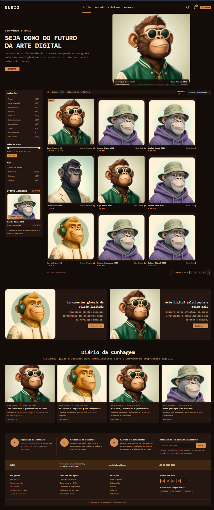
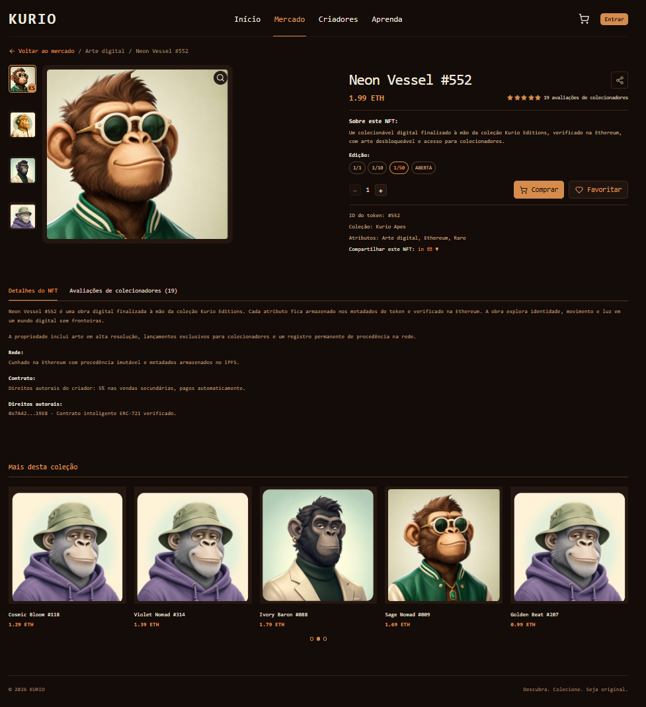
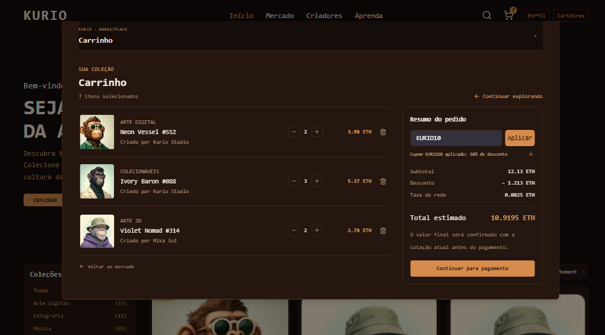
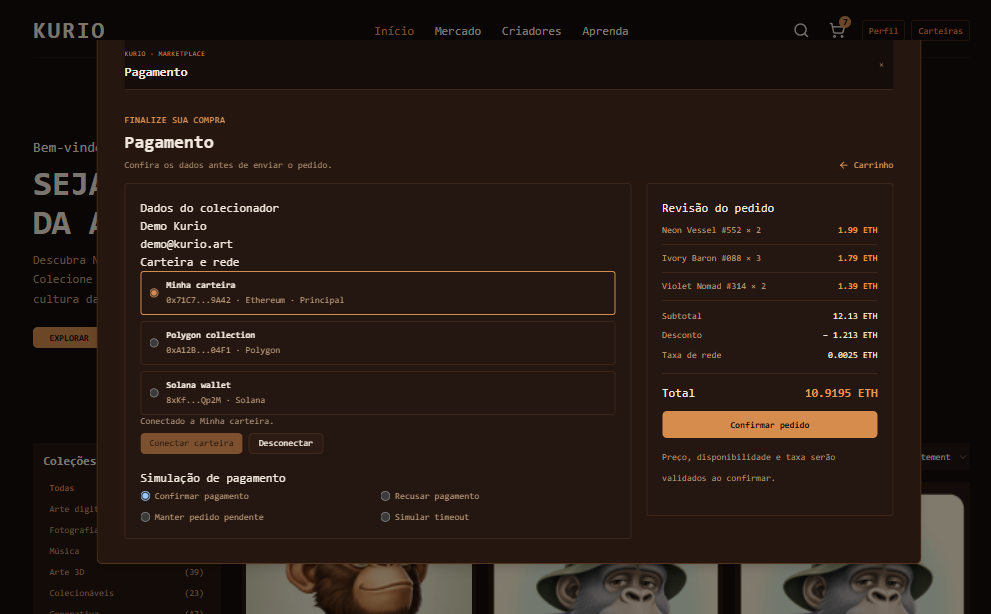
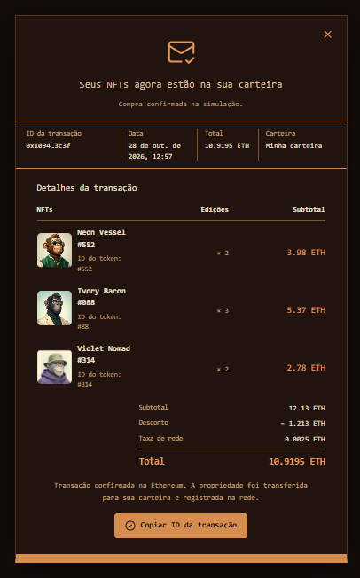
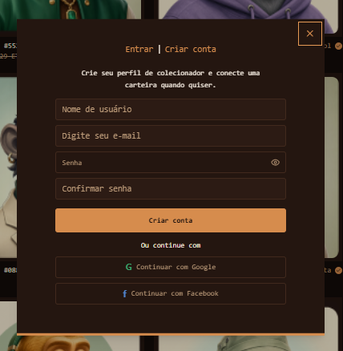
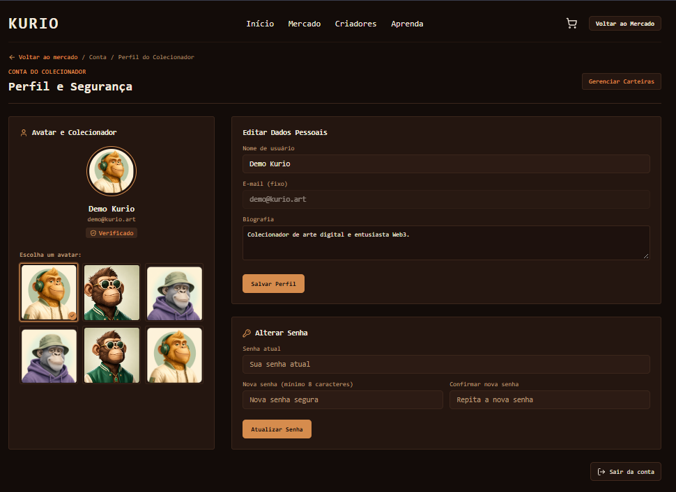

# Kurio — Marketplace de NFTs

Aplicação de marketplace de NFTs feita para o teste técnico. Inclui catálogo pesquisável, detalhe de NFT, conta, carrinho, checkout e recibo, com API simulada por MSW e atualização em tempo real via Socket.IO simulado.

- **Aplicação publicada:** [react-ntf-market-iota.vercel.app](https://react-ntf-market-iota.vercel.app/)
- **Repositório:** [LeooRibeiro/react-NTF-Market](https://github.com/LeooRibeiro/react-NTF-Market)
- **Arquitetura e decisões:** [ARCHITECTURE.md](./ARCHITECTURE.md)
- 
## Acesso de demonstração

- **E-mail:** `demo@kurio.art`
- **Senha:** `KurioPass123`
- **Cupom válido:** `KURIO10` — aplica 10% de desconto no subtotal.

## Telas do projeto

### Início e catálogo



### Detalhes do NFT



### Carrinho e cupom



### Pagamento e escolha da carteira



### Confirmação e recibo



### Login e cadastro



### Perfil e segurança



## Requisitos e implementação

| Tópico | O que é entregue | Estado |
| --- | --- | --- |
| Escopo e telas | Catálogo, detalhe, carrinho, checkout, recibo, login/cadastro, perfil e carteiras. | ✅ |
| Stack | React, TypeScript, TanStack Router/Query, Axios, Tailwind CSS, Radix UI, MSW, Socket.IO, Playwright e Lighthouse. | ✅ |
| Estado e integração | Busca/filtros na URL, cache por domínio, mutations, favoritos otimistas com rollback, persistência por conta e idempotência de pedido. | ✅ |
| API e mocks | Contratos REST simulados, fixtures e cenários de sucesso, falha, latência, sessão expirada, cotação alterada e timeout. | ✅ |
| Tempo real | Eventos Socket.IO simulados para preço, disponibilidade e pedido; cotação é invalidada e pode ser reconciliada com REST. | ✅ |
| Responsividade e acessibilidade | Desktop/tablet/mobile, viewport de 320 px, navegação por teclado, foco visível, labels, erros associados, status anunciados e drawers roláveis. | ✅ |
| Playwright | 25 testes aprovados no Edge, incluindo fluxos, recuperação, tempo real, acessibilidade, viewport tablet e regressão visual desktop/mobile. | ✅ |
| Lighthouse | Medianas de três execuções em home e detalhe, desktop/mobile, dentro das metas definidas no teste. | ✅ |

Consulte [Resultados Lighthouse](./lighthouse-reports/README.md) e [Arquitetura](./ARCHITECTURE.md) para evidências e decisões técnicas.

## Requisitos para executar localmente

- Node.js **20.19+** ou **22.12+**.
- npm (o `package-lock.json` está versionado; use `npm ci`).
- Microsoft Edge instalado para rodar Playwright; Chrome ou Edge para Lighthouse.

## Instalação e desenvolvimento

```bash
git clone https://github.com/LeooRibeiro/react-NTF-Market.git
cd react-NTF-Market
git checkout codex/fix-language-statistics
npm ci
npm run dev
```

O Vite informa a URL local no terminal. O MSW inicia automaticamente no navegador antes da interface; nenhum backend ou serviço privado é necessário.

## Comandos

| Comando | Ação |
| --- | --- |
| `npm run dev` | Desenvolvimento com MSW. |
| `npm run typecheck` | Verificação TypeScript. |
| `npm run lint` | ESLint sem avisos. |
| `npm run build` | Verificação de tipos e build de produção em `dist/`. |
| `npm run preview` | Serve localmente o build de produção. |
| `npm run test:e2e` | Playwright no Microsoft Edge; inicia o Vite automaticamente. |
| `npm run audit:lighthouse` | Executa três auditorias por página e perfil e atualiza `lighthouse-reports/`. Requer PowerShell e Edge/Chrome; baixa a versão de Lighthouse fixada na configuração. |

## Cenários, falhas e reset

No checkout, escolha uma opção em **Simulação de pagamento** antes de confirmar:

- **Confirmar pagamento:** gera pedido confirmado e recibo.
- **Recusar pagamento:** mostra a recusa e preserva os itens no carrinho.
- **Manter pedido pendente:** cria pedido pendente, recuperável após atualizar a rota do pedido.
- **Simular timeout:** persiste a tentativa e simula falha de rede; a ação de recuperação consulta a tentativa idempotente.

Para os outros cenários, abra o DevTools na aplicação e use a aba Console. Os helpers existem no build de demonstração enquanto MSW está ativo. Depois do comando, acione a ação da interface que faz uma nova consulta (por exemplo, mudar a busca ou filtro):

```js
// Forçar catálogo vazio
window.__kurioConfigureNetwork({ emptyCatalog: true })

// Latências variadas nas próximas consultas do catálogo
window.__kurioConfigureNetwork({ variableLatency: true, latencySequence: [800, 35, 140] })

// Duas respostas 503 para exercitar estado de erro e nova tentativa
window.__kurioQueueNetworkFailure('GET /api/nfts', { kind: 'http', status: 503 }, 2)

// Falha de rede ao favoritar (entre no detalhe e clique em Favoritar)
window.__kurioQueueNetworkFailure('POST /api/favorites', { kind: 'http', status: 503 })

// Expirar a sessão da conta atual
window.__kurioExpireSession()

// Emitir evento Socket.IO de mudança de preço para um NFT
window.__kurioUpdateNftPrice('neon-vessel-552', '2.50')
```

Cupom inválido: aplique qualquer código diferente de `KURIO10` no carrinho. Para retornar ao estado inicial, execute no Console e atualize a página:

```js
window.__kurioResetData()
location.reload()
```

O reset limpa sessão, dados locais, cenários de rede e alterações do catálogo. Também é possível limpar os dados do site no navegador; isso remove a sessão e o carrinho da conta atual.

## Testes e auditoria

A suíte Playwright foi executada no Edge em 28/10/2026: **25 aprovados**. Para reproduzir, instale o Microsoft Edge, execute `npm ci` e `npm run test:e2e`. Os testes visuais comparam home, detalhe, carrinho e checkout em desktop e mobile.

Os relatórios Lighthouse versionados foram produzidos em build local de produção com MSW e throttling simulado. As medianas atendem às metas: Performance ≥ 90, Accessibility ≥ 95, Best Practices ≥ 95 e SEO ≥ 90. O detalhe mobile ficou no limite de performance (90) e tem LCP mediano de aproximadamente 3,5 s; veja a análise em `lighthouse-reports/README.md`.

## Limitações conhecidas

- O backend é simulado pelo MSW no navegador; desabilitar mocks sem fornecer uma API compatível deixa as chamadas `/api` sem serviço.
- Login, pagamento, carteiras, transações e eventos não representam serviços financeiros ou blockchain reais.
- Os dados persistem no armazenamento local do navegador e não são compartilhados entre dispositivos.
- A arte principal do detalhe é carregada depois da consulta do NFT, o que aumenta o LCP mobile.

## Créditos e ajustes de assets

As artes e fontes usadas pela interface ficam no projeto em `public/assets`. Conforme solicitado, as referências que usavam `cosmic-bloom.png` foram substituídas por `golden-beat.png`, e o arquivo antigo foi removido. As capturas desta documentação também ficam nessa pasta. A paleta e a tipografia do layout foram mantidas; ajustes de responsividade e acessibilidade estão descritos em `ARCHITECTURE.md`.
